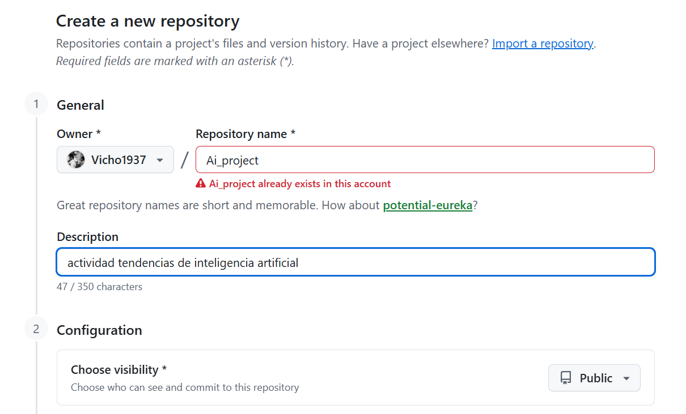
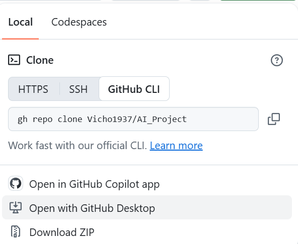
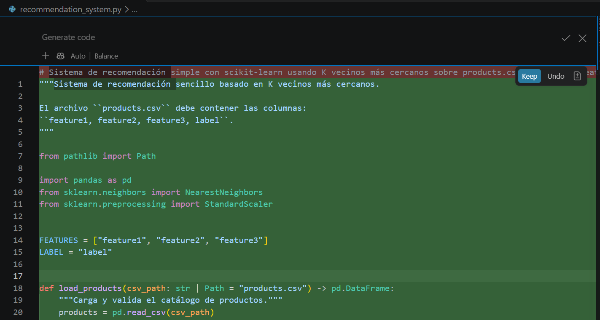
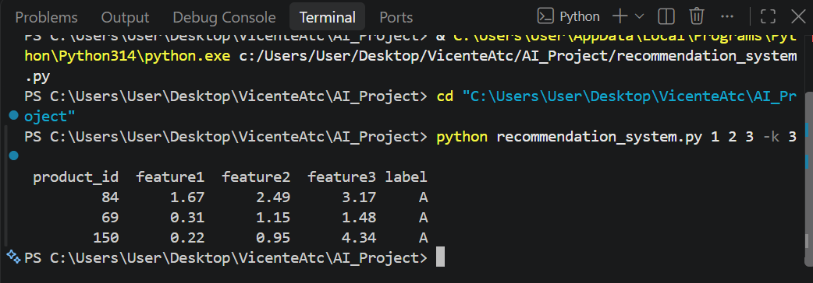
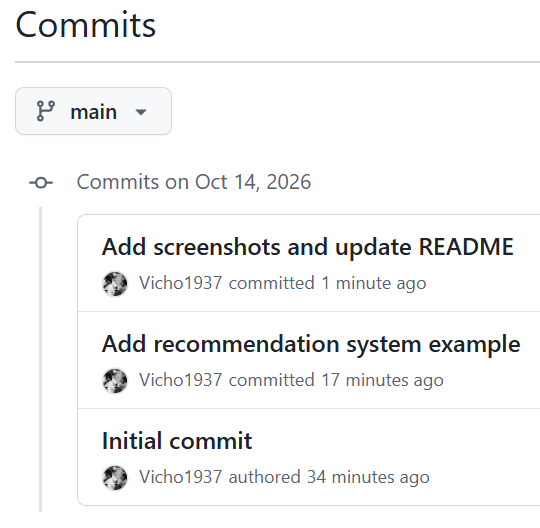

# AI_Project: sistema de recomendación con GitHub Copilot

**Autor:** Vicente Juanpablo García Torres
**Carrera:** Ingeniería en Informática, INACAP
**Actividad:** Actividad formativa: GitHub Copilot (tendencias emergentes en IA)

## Objetivo

Explorar GitHub Copilot como herramienta práctica de IA generativa para programar. Con su ayuda se genera un sistema de recomendación simple en Python, que se documenta y se sube a GitHub siguiendo el flujo de trabajo con Git (clonar, crear archivos, `add`, `commit` y `push`).

## Contenido del repositorio

| Archivo | Descripción |
|---|---|
| `recommendation_system.py` | Sistema de recomendación por K vecinos más cercanos (scikit-learn), generado con Copilot |
| `products.csv` | Dataset de ejemplo con 200 productos sintéticos (3 características y una categoría A/B/C) |
| `README.md` | Este documento, con el proceso seguido |

## Proceso seguido

### 1. Cuenta de GitHub y plan gratuito

Ingresé a [github.com](https://github.com/), creé mi cuenta con mi correo, lo validé y en la sección de precios elegí el plan **Gratis**. Luego activé GitHub Copilot desde mi cuenta.


### 2. Creación del repositorio

Creé el repositorio público `AI_Project` con un README inicial.



### 3. Clonar el repositorio en Visual Studio Code

```bash
git clone https://github.com/Vicho1937/AI_Project.git
cd AI_Project
```



### 4. Crear el archivo con GitHub Copilot

En Visual Studio Code, con Copilot integrado, le pedí el código con esta descripción:

```text
# Sistema de recomendación simple con scikit-learn usando K vecinos más cercanos sobre products.csv (feature1, feature2, feature3, label)
```

Copilot escribió el archivo `recommendation_system.py` completo.



El código generado:

1. Importa `pandas` y, de `scikit-learn`, `NearestNeighbors` y `StandardScaler`.
2. `load_products()` carga `products.csv` y valida que existan las columnas `feature1`, `feature2`, `feature3` y `label`, que no esté vacío y que no haya valores nulos.
3. `recommend()` normaliza las características con `StandardScaler` (para que ninguna pese más que otra por su escala) y busca los productos más cercanos al producto consultado con `NearestNeighbors`.
4. Se ejecuta desde la terminal, recibiendo las 3 características y, con `-k`, cuántas recomendaciones mostrar.

**Ajustes después de revisar el código:**

- Copilot no incluyó datos, así que se generó un `products.csv` de ejemplo con 200 productos sintéticos (semilla fija para que sea reproducible).
- Al ejecutarlo, scikit-learn mostraba la advertencia `X does not have valid feature names`, porque la consulta se pasaba como lista. Se corrigió pasándola como `DataFrame` con los mismos nombres de columna.

### 5. Ejecución

```bash
pip install numpy pandas scikit-learn
python recommendation_system.py 1 2 3 -k 3
```

Salida obtenida:

```text
 product_id  feature1  feature2  feature3 label
         84      1.67      2.49      3.17     A
         69      0.31      1.15      1.48     A
        150      0.22      0.95      4.34     A
```

Para un producto con características (1, 2, 3), el sistema recomienda los tres productos más parecidos del catálogo, todos de la categoría A.



> Nota: el dataset es de ejemplo (datos sintéticos), por lo que el resultado sirve para comprobar que el flujo funciona y no para sacar conclusiones sobre productos reales.

### 6. Commit y push

```bash
git add .
git commit -m "Add recommendation system example"
git push -u origin main
```



> Como el repositorio se creó en GitHub y se clonó, el remoto `origin` ya está configurado y no hace falta ejecutar `git remote add origin`.

### 7. Entrega

Copié el enlace del repositorio en un documento Word con mis datos y lo subí al aula virtual (AAI).

## Reflexión sobre el uso de Copilot

Copilot generó en segundos un código más completo de lo pedido, con validaciones, normalización de datos y uso por terminal. Aun así sus sugerencias deben revisarse: no incluyó los datos que el programa necesita y al ejecutarlo apareció una advertencia que hubo que corregir. Fue una ayuda para programar más rápido, no un reemplazo del criterio propio.

## Referencias

GitHub. (s. f.). *GitHub Copilot Documentation*. https://docs.github.com/en/copilot

GitHub. (s. f.). *Getting Started with GitHub Copilot*. https://docs.github.com/en/copilot/getting-started-with-github-copilot
